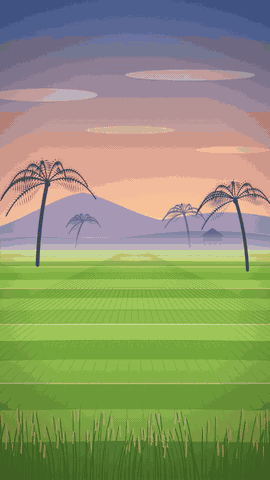
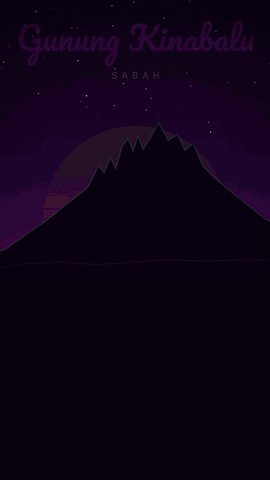
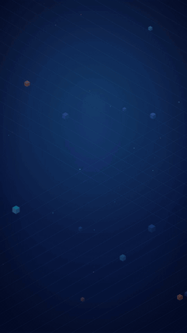
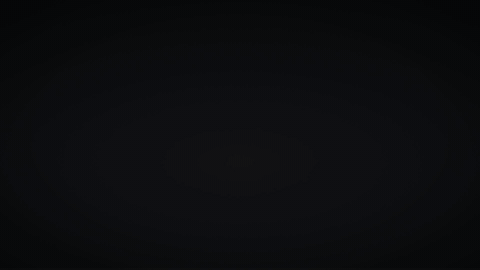
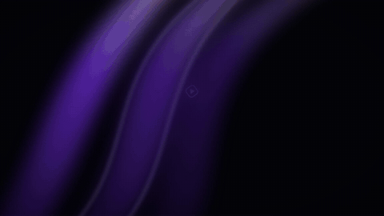
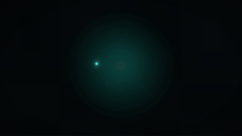

# 🎬 Claude Remotion Skill — Make AI Video Editing & Motion Graphics with Claude

[](LICENSE)
[](https://docs.anthropic.com/en/docs/claude-code)
[](https://remotion.dev)
[](https://github.com/haidrrrry/claude-remotion-skill)

**An open-source [Claude](https://claude.com) agent skill that turns Claude Code, Claude Desktop, and Claude AI into a real motion-graphics editor.** It teaches Claude to create and edit professional **AI videos with [Remotion](https://remotion.dev)** — springs, staggered choreography, color grades, film grain, Ken Burns, word-synced captions, and sound design — from a single prompt. Text to video, the way an actual editor would do it.

> If you've ever asked an AI to "make a video" and gotten flat fades and linear motion, this is the fix. **Remotion is never the bottleneck — motion-design craft is.** This skill encodes that craft as hard rules plus a mandatory **render → inspect frames → fix → re-render** loop, so Claude verifies its own output instead of shipping blind.

## 🎥 Demo — made with this skill

[](https://github.com/haidrrrry/claude-remotion-skill/raw/main/demo.mp4)

> A motion-graphics clip produced by Claude Code using this skill. ▶️ [Watch/download the full-quality MP4 (with audio)](https://github.com/haidrrrry/claude-remotion-skill/raw/main/demo.mp4)

## 🤖 What is this? (TL;DR)

**Claude Remotion Skill** is a free, open-source [agent skill](https://docs.anthropic.com/en/docs/claude-code) for Anthropic's Claude. You install it once, then ask Claude — in plain English — to make or fix a video, and Claude renders a finished, professionally animated clip using Remotion (React + TypeScript for video). It handles motion design, B-roll, captions, transitions, and sound design automatically.

## ❓ FAQ

**Can Claude edit videos?**
Yes. Out of the box Claude can write video code; with this skill it produces *professional* motion graphics — proper easing, staggered timing, color grading, grain, captions — and verifies the render by extracting and inspecting frames before delivering.

**Do I need After Effects or Premiere?**
No. Everything runs in code via [Remotion](https://remotion.dev) (React + TypeScript). No timeline software, no manual keyframing. You describe the video; Claude builds and renders it.

**Which Claude models work?**
Claude Code and Claude Desktop on Sonnet or Opus. The skill is model-agnostic — any Claude that supports agent skills can use it.

**Is it free?**
Yes. MIT licensed, fully open source. You only need Remotion (free, open source) and a Claude subscription/API access.

**What can it make?**
Logo animations, brand intros, vertical Reels/Shorts/TikToks, faceless content videos, product explainers, animated captions/subtitles, lower thirds, kinetic typography, and B-roll-driven edits.

**How is this different from text-to-video models (Sora, Runway, etc.)?**
Those generate pixels and hallucinate. This produces *deterministic, editable, brand-controlled* motion graphics from real code — exact text, exact colors, exact timing, re-renderable forever.

## 🆚 Generic AI video vs. with this skill

| Without this skill | With Claude Remotion Skill |
|---|---|
| Linear interpolation everywhere | Springs + bezier curves only (`easeOutExpo`, presets) |
| Lonely opacity fades | 3-property entrances (fade + rise + scale) |
| Everything enters at once | Staggered choreography (3–6 frame offsets) |
| Flat solid backgrounds | Drifting gradient mesh + grade + grain + vignette stack |
| Static pasted images | Ken Burns on every still, `OffthreadVideo` for footage |
| Ships unverified renders | ffmpeg frame extraction + visual inspection, every time |

## 📦 What's inside

```
remotion-motion-graphics/
├── SKILL.md                    # Workflow + 10 non-negotiable motion rules
├── references/
│   ├── motion-patterns.md      # 17 copy-paste components (reveals, grade, grain,
│   │                           #   Ken Burns, counters, transitions, captions...)
│   ├── design-rules.md         # Palettes, typography, pacing, sound, checklist
│   ├── product-promo.md        # App/SaaS launch patterns: device mockup, UI rack
│   │                           #   focus, 3D camera, shape morphs, logo bookend
│   ├── light-path.md           # One glowing line as the story: path drawing,
│   │                           #   branches, waveform, odometer, leaderboard climb
│   ├── ai-demo.md              # Prompt → code → result demos: typing, code stream,
│   │                           #   one-canvas camera, chips, text on a path
│   └── customer-journey.md     # Logo → buy → delivery map → doorstep: sparks,
│                               #   card orbit, isometric city, CSS 3D box
└── assets/
    └── theme.ts                # Theme template (colors, easings, spring presets)
```

## 🚀 Install

**Claude Code (per-user — available in every project):**
```bash
git clone https://github.com/haidrrrry/claude-remotion-skill.git
mkdir -p ~/.claude/skills
cp -r claude-remotion-skill/remotion-motion-graphics ~/.claude/skills/
```

**Claude Code (per-project — share with your team):**
```bash
git clone https://github.com/haidrrrry/claude-remotion-skill.git
mkdir -p .claude/skills
cp -r claude-remotion-skill/remotion-motion-graphics .claude/skills/
```

**Pair it with the official Remotion skills** (API reference for motion blur,
transitions, 3D, light leaks, captions, rendering). This repo already ships them
in `.claude/skills/`, pinned in `skills-lock.json`; to add them to your own project:
```bash
npx skills add remotion-dev/skills -a claude-code -s '*' -y --copy
```

**Claude Desktop / Claude.ai:** upload `remotion-motion-graphics.skill` in **Settings → Capabilities → Skills**.

**Verify it worked:** ask Claude *"make me a 3 second logo sting"*. It should read the skill before writing any code, and it should extract and inspect frames before delivering. A render shipped without frame checks means the skill is not loaded.

**Update later:** run `git pull` in your clone, then copy the folder again (on Desktop, re-upload the `.skill` file).

## 🎯 Usage

Just talk to Claude normally — the skill triggers itself:

- *"Create a 5 second logo animation for my brand"*
- *"My Remotion video looks generic and basic, fix it"*
- *"Add word-synced captions to this clip"*
- *"Build a vertical Reel intro, dark tech aesthetic"*

Claude reads the skill, applies the motion rules, renders with Remotion, extracts frames with ffmpeg, inspects them, fixes issues, and only then delivers.

## 🧠 The 10 rules (short version)

1. Never linear interpolation — springs/bezier + clamp, always
2. Entrances animate 2–3 properties together
3. Stagger everything
4. Exits exist and are faster than entrances
5. Five-layer stack: bg mesh → assets → graphics → grade → grain+vignette
6. Every still gets Ken Burns; footage uses `OffthreadVideo`
7. Idle elements breathe (sin-wave micro-motion)
8. All timing derives from `fps` — no magic frame numbers
9. One `theme.ts` — no inline colors or easings
10. Render → inspect frames → fix → re-render. Never ship unverified.

## Examples

[`examples/`](examples/) is a Remotion project with eleven finished compositions built with this skill: a profile promo, the Focus Cat app promo, a "watch this video fix itself" demo where the motion rules apply themselves one by one, a beat-synced code edit with a synthesized 120 BPM track, KL Night, a vertical Reel of the Kuala Lumpur skyline drawn entirely in SVG, Tanah Airku, a wau bulan's flight across Malaysia, Malaysia Neon, the same country as flickering neon signs, a 56-second isometric explainer, Kerja Makan Gaji vs Kerja Sendiri, with beat-analyzed music and a Bahasa Melayu voice-over, Kedai, an app-launch promo built from the product-promo patterns, Prompt to Video, an AI-demo of the skill itself, and Laju, a logo-to-doorstep delivery promo. Each shipped only after the render, inspect frames, fix, re-render loop.

Here is the Focus Cat promo, 15.5 seconds, with a pixel-art mascot drawn in code. Click it for the MP4 with sound:

[](https://github.com/haidrrrry/claude-remotion-skill/raw/main/examples/videos/focus-cat-promo.mp4)

And KL Night, a 20-second 9:16 Reel. The Petronas Towers and Menara KL draw themselves line by line, 388 windows light up while a counter tracks them, and the fireworks run on drag-and-gravity physics, ending in a heart. There are no image, video, or audio files: the 100 BPM gamelan-flavored track is synthesized, and each firework is panned to where it bursts. Click it for the MP4 with sound:

[](examples/videos/kl-night.mp4)

And Tanah Airku, a 25-second 9:16 Reel. A wau bulan flies over a Kedah paddy field at dawn, whip-pans to a Terengganu fishing boat at sunset, then the camera dives into the kite's center flower and comes out in a batik pattern drawn by canting, where a bunga raya blooms. Its petals open into the Jalur Gemilang. The score is an original zapin piece: Karplus-Strong gambus in the Hijaz mode, marwas, seruling, and a closing gong. Click it for the MP4 with sound:

[](examples/videos/tanah-airku.mp4)

And Malaysia Neon, the same country as neon signs, 25 seconds. Gunung Kinabalu's granite crown traced in cyan over a synthwave sun and grid, a Pohon Beringin twirled onto a lamp-lit wayang kulit screen, a nasi lemak sign stuttering to life tube by tube on a mamak's brick wall, and MALAYSIA lit letter by letter over a wet street. Every flicker you see has a buzz-click you hear, and a virtual camera shakes on every kick, ignition and power cut, with an RGB split on the big hits. Click it for the MP4 with sound:

[](examples/videos/malaysia-neon.mp4)

And Kerja Makan Gaji vs Kerja Sendiri, a 56-second isometric explainer in Bahasa Melayu. An office worker watches the clock spin from 9 to 6 and the salary drain into rent, car and bills. An online seller packs orders while sales notifications land and a revenue graph spikes, then drops. A split-screen weighs both sides, and the video ends on "Kau pilih yang mana? Komen di bawah." The music is an original 120 BPM track. A blind beat analysis (onset autocorrelation plus chroma downbeats) confirms the grid to within 7.5 ms, and every camera move, whip-pan, card, voice-over phrase and SFX lands on a beat. Click it for the MP4 with sound:

[](examples/videos/kerja-makan-gaji-vs-kerja-sendiri.mp4)

And Kedai, a 23.5-second app-launch promo for an invented Malaysian shop app, built from `references/product-promo.md`. One amber light travels through the whole video: a logo lockup unmasks, a phone tilts in and the camera zooms through its app icon, focus racks down a product list, a live dashboard cascades in under a tilted camera with KL pulsing on a dotted map, and "dan dengar jualan pertama anda" collapses into a glowing pill that springs open into the first order. Click it for the MP4 with sound:

[](examples/videos/kedai-launch.mp4)

And Prompt to Video, a 15-second demo of this skill in the ai-demo style. A prompt types itself ("Buat intro logo 5 saat untuk kedai kopi saya, Kopi Senja."), Remotion code streams past, and a player swings in playing the generated logo intro; the camera whips to a second prompt and back to the night version, then the sign-off flies in along a curve. Click it for the MP4 with sound:

[](examples/videos/prompt-to-video.mp4)

And Laju, a 21-second delivery promo for an invented marketplace: a spark comet draws the route mark, product cards orbit a phone, "Beli Sekarang" fills into an order, the route crosses an isometric city, the mark is drawn on a box at the door, and "Dari Perlis ke Sabah." closes with an arrow from the P to the S. Click it for the MP4 with sound:

[](examples/videos/laju-journey.mp4)

The others render from source in a few minutes:

```bash
cd examples
npm install
npm run audio            # synthesize the SFX and music, no asset files needed
npm run render:selffix   # or render:laju / render:prompt / render:kedai / render:kerja / render:neon / render:tanahairku / render:kl / render:codeedit / render:profile / render:focuscat
```

## 🤝 Contributing

PRs welcome — new motion patterns, palettes, or fixes. See [CONTRIBUTING.md](CONTRIBUTING.md).

## ⭐ Star this repo

If this saved you from shipping another flat-fade video, **[star it](https://github.com/haidrrrry/claude-remotion-skill)** — it helps other people find it.

## 📄 License

[MIT](LICENSE) — use it, fork it, ship videos with it.

---

Made by [@haidrrrry](https://github.com/haidrrrry) · Follow [@haidercodes](https://instagram.com/haidercodes) for AI + dev content
